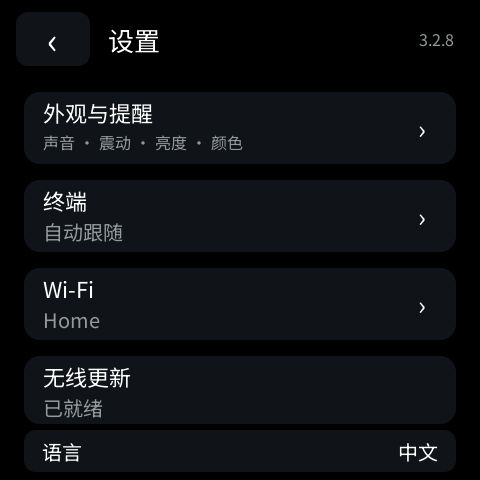
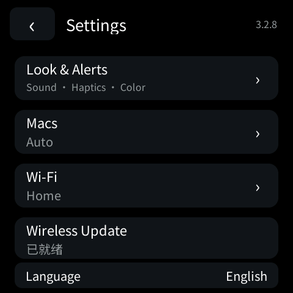
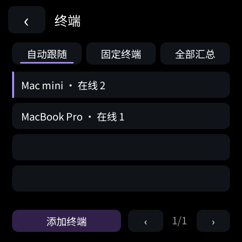
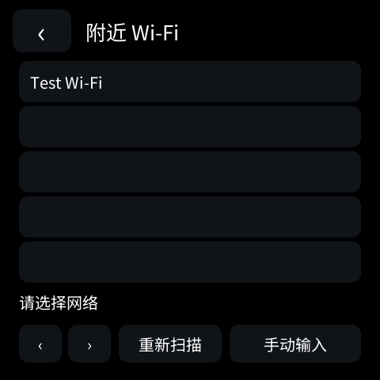
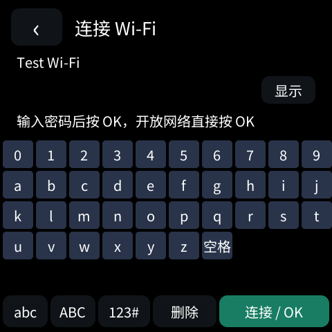
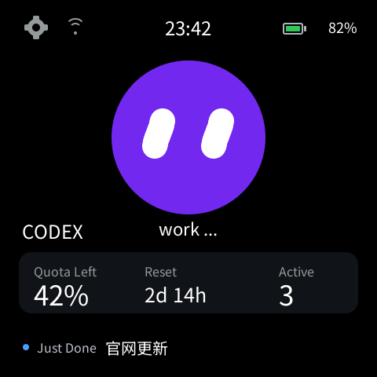
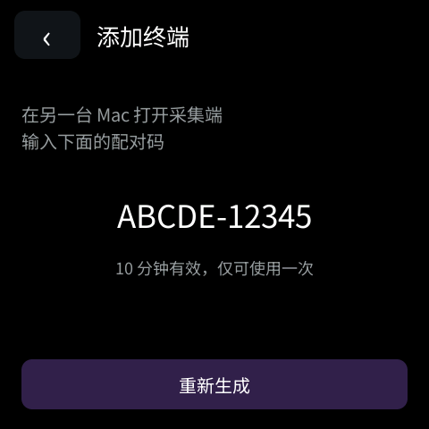
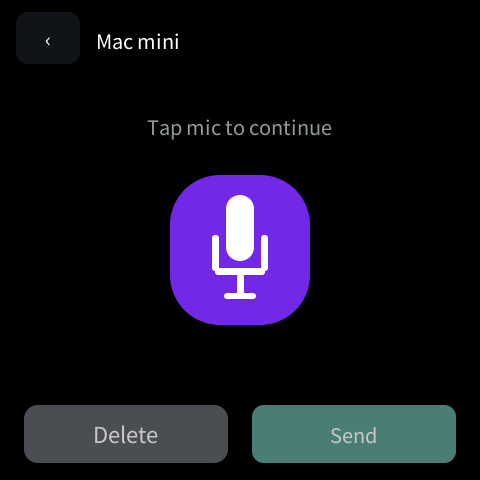
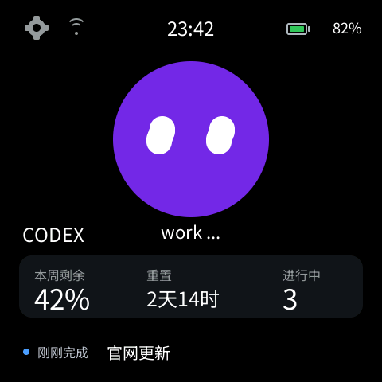

# ESP-Mosaico Vibe coding固件

**ESP-Mosaico Vibe coding固件** is an open-source Codex desk pet for the ESP-Iris Mosaico (ESP32-S31). It shows live Codex quota, reset countdown, running tasks and recent activity on an animated, code-rendered face. Tap the face to dictate into Codex on a Mac. Data synchronizes over Wi-Fi; USB is only needed for initial provisioning or maintenance.

[中文说明](#中文说明) · [功能详情](#功能详情) · [页面截图](#页面截图) · [安装与配置](#安装与配置) · [English](#english)

## 页面截图

以下为 **480 × 480 原生模拟器截图**，使用与设备相同的 GSP 场景和 C 界面逻辑。画面中的额度、任务、Mac 名称和 Wi-Fi 名称都是演示数据；不会公开真实账号、配网密码或语音内容。

| 桌宠主屏：额度、倒计时、任务 | 任务列表：运行与未读状态 | 语音输入：麦克风、波形与发送 |
| --- | --- | --- |
|  |  |  |

| 最近交互回退 | 设置入口 | 外观与提醒 |
| --- | --- | --- |
|  |  |  |

| 中英语言切换 | 多台 Mac 与终端模式 | 已保存的 Wi-Fi |
| --- | --- | --- |
|  |  |  |

| 扫描附近网络 | 屏幕输入 Wi-Fi 密码 | 英文桌宠主屏 |
| --- | --- | --- |
|  |  |  |

| 添加另一台 Mac：一次性配对码 | 英文语音页面 | 首次等待数据的状态 |
| --- | --- | --- |
|  |  |  |

## 中文说明

这是一套基于 [ESP-Mosaico Vibe](https://github.com/esp-mosaico/esp-mosaico-vibe) 工作区、ESP-Iris Mosaico 硬件和 ESP32-S31 的开源 Codex 桌宠固件及 Mac 配套程序。我们使用该工作区固定的工具链、板级支持包、GSP 模拟器、Iris 通信和 Vibe/Recovery 更新流程，在其中开发独立的 `codex_pet` 应用；本仓库不是上游项目的官方固件或完整镜像。依赖版本和代码来源见[依赖说明](docs/dependencies.md)。

主屏用原生绘图呈现紫色机器人表情、眨眼动画、电量、时间、Wi-Fi 状态、Codex 剩余额度、重置倒计时和进行中的任务数。下方优先展示刚刚完成的任务；没有新完成任务时显示最近一次交互的任务名称与状态。

## 功能详情

| 页面 / 能力 | 实际功能 |
| --- | --- |
| 桌宠主屏 | 黑色背景、代码绘制的机器人表情与眨眼动画；显示时钟、彩色电量、Wi-Fi 状态、`work ...`、本周剩余额度、重置倒计时和进行中任务数。点击表情进入语音页。 |
| 任务与最近交互 | 点击额度卡片或底部详情进入任务列表；进行中显示转圈，完成且未读显示绿点。底部优先显示刚刚完成的任务内容，没有未读完成任务时回退到最近一次交互。 |
| 完成提醒 | 新完成事件可触发震动和设备本地合成提示音；设置中分别控制声音、音量和震动。 |
| Mac 本地语音输入 | 设备麦克风录音，显示实时音波和状态；Mac 上的 Qwen3-ASR 转写并写入当前 Codex 输入框。语音页支持删除和发送；音频不上传到业务中继。 |
| 多台 Mac | 每台 Mac 使用独立身份上报。可自动跟随正在工作的 Mac、固定一台终端，或汇总任务；共享任务去重，不把不同账号的额度相加。支持一次性配对码添加终端。 |
| 多个 Wi-Fi | 设备可扫描附近网络、屏幕输入密码并连接；最多保存 8 个网络。可在网络详情中连接、设为首选或删除；掉线后按可见网络与优先级尝试重连。凭证保存在设备，不进入公开仓库。 |
| 外观与语言 | 六种代码绘制的桌宠颜色：紫、蓝、薄荷绿、橙、粉、青；支持亮度调节。设置页可在中文和 English 之间切换，语言及外观选择保存在设备上。任务名称、Wi-Fi 名称和 Mac 名称保留原始内容。 |
| 无线运行与更新 | Mac 上传额度和任务状态到中国大陆 HTTPS 中继，设备通过 Wi-Fi 获取状态和服务器时间，无须持续插 USB。Mac 可选择 `.irisfw` 包，经保留的 Vibe/Recovery 流程无线更新应用，并保留设备配置。 |

### 主屏与任务

- **一眼读状态**：顶部显示设置、Wi-Fi、服务器时间和电池百分比；电池图标按电量使用绿、黄、红提示色。中间的机器人由场景和代码绘制，空闲、工作、等待、完成、失败对应不同表情，并有眨眼动画。
- **额度卡片**：显示当前 Codex 剩余额度、距离重置的天/小时/分钟，以及当前进行中的开发者任务数。点击卡片进入任务列表，任务行用转圈表示运行中，用绿点表示“已完成且结果未读”。
- **底部详情**：有新完成任务时展示具体任务内容；没有新完成任务时展示最近一次交互。点击详情也能进入任务列表。数据失联时显示等待或离线状态，避免把缓存当作实时结果。

### 语音、提醒与外观

- **语音输入**：点击桌宠表情进入语音页，点击麦克风开始或停止听写。设备显示声音波形和连接、加载、识别状态；Mac 本地 Qwen3-ASR 将文字写入当前 Codex 输入框。设备上的删除键可删字，长按可清空本次文字，发送键提交当前输入。语音页没有第二个文本编辑框。
- **完成提示**：新完成事件可触发震动及三音提示音。可分别关闭声音或震动，调整音量、亮度，或试听当前音量；声音默认值为 50%。
- **六种颜色**：紫、蓝、薄荷绿、橙、粉、青。颜色由代码绘制，外观和语言选择保存在设备上，重启后仍生效。

### 网络、终端与固件

- **直接配网**：在设备设置中扫描附近 Wi-Fi，点选网络、用屏幕键盘输入密码并连接；支持重新扫描和手动输入 SSID。最多保存 8 个网络，可查看当前连接、调整首选顺序或删除。连接失败时继续尝试其他已保存网络。
- **多台 Mac**：每台 Mac 独立上报；设置中可选“自动跟随正在工作的 Mac”“固定终端”或“全部汇总”，并显示终端名称、在线状态和活跃任务数。添加终端使用一次性配对码。汇总任务会去重，不跨账号叠加额度。
- **固件版本**：设置页可查看更新就绪状态；Mac 可选择兼容的 `.irisfw` 文件更新。设备保留 Recovery 与配置分区。这里的“多个固件”是可选择不同版本更新包，并非设备内同时安装、随时切换多个应用。

### 双语范围

设置 → **语言 / Language** 可切换中文和 English。主屏、状态、任务页、设置、终端、Wi-Fi 配网与语音页的界面文案随之切换；服务器下发的任务标题、用户自定义 Wi-Fi 名称、Mac 名称保持原文。语言选择保存在设备 NVS 中。

**固件模式说明：**设备保留应用固件与 Vibe/Recovery 维护模式，更新时可选择不同版本的 `.irisfw` 包。当前设置页没有“安装并一键切换多个应用固件”的功能，也没有声称可同时运行多套桌宠应用。

主界面、表情、图标和动画由代码及 GSP 场景生成，设备不接收整屏图片流。配网、终端选择和外观设置的更多行为见[多 Mac 与 Wi-Fi 设计及验证](docs/multi-mac-3.0.1.md)。

### 数据路径

```text
Codex on Mac ── status/quotas ──> HTTPS relay in mainland China ── Wi-Fi ──> Mosaico
Mosaico mic ── local-network TLS audio ──> Mac local Qwen3-ASR ──> Codex composer
```

语音音频与识别文字不经过业务中继。服务器地址、令牌、Wi-Fi 密码、Mac 私钥和用户数据均不随源码发布。公开源码需要自行配置自己的服务器和本机模型。

## 安装与配置

目标硬件为 **ESP-Iris Mosaico，ESP32-S31**，不是通用 ESP32-S3 开发板。固件采用 ESP-IDF 固定版本 `7b9cc1ac79f865983f59bb8ff3ff43eb74ff1dbe`、ESP-Mosaico 官方工作区及 GSP 原生模拟器。先按[依赖说明](docs/dependencies.md)准备上游组件，再生成场景、运行测试和构建。设备更新必须使用 `python mosaico.py iris system-update` 的官方流程；保留 Recovery、NVS 和原有分区，不使用全片擦除。

1. 按[依赖说明](docs/dependencies.md)准备官方 ESP-Mosaico Vibe 工作区和固定版本工具链，将[固件源码](firmware/projects/codex_pet)作为 `projects/codex_pet` 应用使用。
2. 配置自己的中国大陆 HTTPS 中继，并在 Mac 上安装[采集与语音服务](companion)。服务器地址、令牌和本地模型路径需按本机环境设置；仓库不附带在线服务凭据。
3. 使用 `python mosaico.py iris system-update --project projects/codex_pet` 安装固件。不要直接全片擦写。设备启动后在设置中扫描 Wi-Fi，并按需要选择终端、语言、颜色和提醒方式。

可继续阅读[数据与多 Mac 设计](docs/multi-mac-3.0.1.md)、[详细语音设计](docs/VOICE-INPUT.md)、[中继服务](server)、[测试](tests)和[验证记录](docs/validation.md)。**3.2.8** 已在同一台 ESP-Iris Mosaico 上通过官方 System Update 写入，设备重启后回报 3.2.8；截图来自模拟器。另一台 Mac、另一种路由器和英文页面的实屏触控仍需分别验收。

## English

This project turns an ESP-Iris Mosaico into a physical companion for Codex. It uses the upstream [ESP-Mosaico Vibe](https://github.com/esp-mosaico/esp-mosaico-vibe) workspace, pinned toolchain, board support, simulator and Vibe/Recovery update flow to build an independent `codex_pet` application. It is not an official upstream firmware image.

The code-rendered pet shows quota remaining, reset countdown, active task count, unread completions, recent interaction, clock, Wi-Fi and battery. Tap the face for local Mac speech-to-text and Codex composer input. Settings include Chinese/English UI selection, six face colors, brightness, sound level, mute and vibration. Language and appearance survive restart; task titles, Wi-Fi SSIDs and Mac names remain in their original language. Save up to eight Wi-Fi networks with on-device scanning, password entry, priority and reconnection. Pair multiple Macs and choose automatic follow, a fixed Mac or merged tasks. Choose an `.irisfw` package for wireless application updates through retained Vibe/Recovery; simultaneous multi-firmware boot selection is not implemented. Firmware, Mac companion, relay source, simulator scene and tests are published together.

The status channel uses a mainland-China HTTPS relay so the pet can run from Wi-Fi and power alone. The voice channel stays on the local network and is processed on the Mac. See the Chinese feature list and linked source directories for setup, behavior and limitations.

## Source layout

- `firmware/projects/codex_pet`: authored firmware, GSP scene generator, native UI and device components.
- `companion`: Mac Codex collector and local voice bridge.
- `server`: multi-Mac relay and validated device snapshots.
- `tools`: setup, pairing and simulator utilities.
- `tests`: state, transport and UI behavior checks.
- `docs/screenshots`: native simulator captures of the current design.

Built on [ESP-Mosaico Vibe](https://github.com/esp-mosaico/esp-mosaico-vibe). Upstream components and copied code retain their respective notices and licenses. This repository is an independent desk-pet application.
