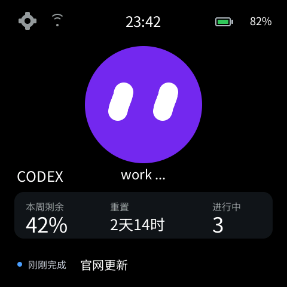
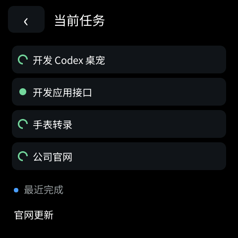
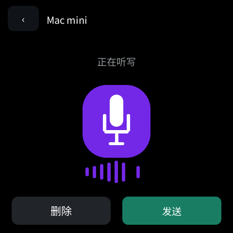
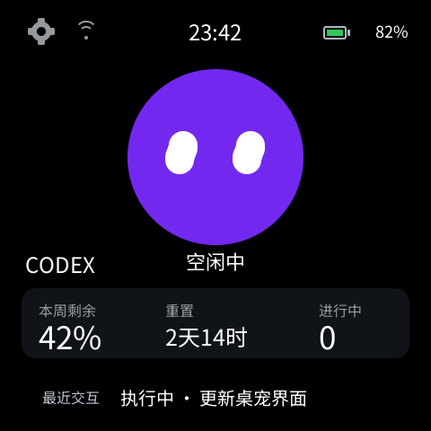
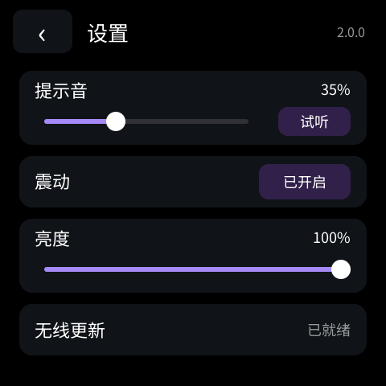
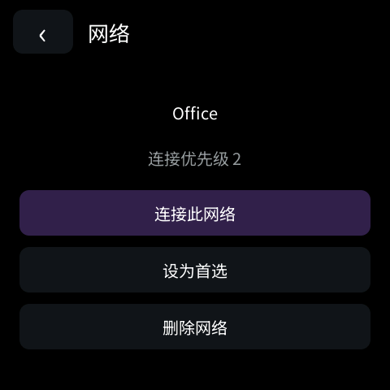

# ESP-Mosaico Vibe coding固件

**ESP-Mosaico Vibe coding固件** is an open-source Codex desk pet for the ESP-Iris Mosaico (ESP32-S31). It shows live Codex quota, reset countdown, running tasks and recent activity on an animated, code-rendered face. Tap the face to dictate into Codex on a Mac. Data synchronizes over Wi-Fi; USB is only needed for initial provisioning or maintenance.

[中文说明](#中文说明) · [English](#english) · [Screenshots](#screenshots) · [Source layout](#source-layout)

## Screenshots

| Home and quota | Task list | Mac voice input |
| --- | --- | --- |
|  |  |  |

| Recent interaction fallback | Settings | Saved Wi-Fi |
| --- | --- | --- |
|  |  |  |

These are screenshots from the project's native simulator using the same scene and portable C UI as the device. Quota figures and task names in screenshots are examples.

## 中文说明

这是一套基于 **ESP-Mosaico Vibe、ESP-Iris Mosaico 和 ESP32-S31** 的开源 Codex 桌宠固件及 Mac 配套程序。主屏用原生绘图呈现紫色机器人表情、眨眼动画、电量、时间、Wi-Fi 状态、Codex 剩余额度、重置倒计时和进行中的任务数。下方优先展示刚刚完成的任务；没有新完成任务时显示最近一次交互的任务名称与状态。

- **任务进展**：点击额度卡片或底部详情进入任务列表。执行中的任务显示旋转状态，已完成但未读的结果显示绿点；完成提示通过震动和本地合成提示音发出。
- **语音输入**：点击桌宠进入语音页，再点击中央麦克风开始或停止听写。音波随音量变化，底部提供删除和发送。桌宠通过局域网 TLS 将音频送到 Mac，Mac 上的 Qwen3-ASR 本地模型转写后写入 Codex 输入框。桌宠没有文字输入框。首次加载模型需要等待，后续常驻服务可复用模型。
- **额度与日期**：Mac 采集 Codex 额度、任务和完成事件并上传有界状态；中国大陆业务服务器通过 HTTPS 将数据和时间下发给设备。设备经 Wi-Fi 自动刷新，不持续依赖 USB。
- **多台 Mac**：设置页支持自动选择正在工作的 Mac、固定一台 Mac 或合并任务。额度不会跨账号相加。
- **网络与偏好**：设备端可扫描 Wi-Fi、输入密码、保存多个网络；设置页可调整桌宠颜色、亮度、音量，关闭声音或震动。
- **资源方式**：主界面、表情、图标和动画由代码及 GSP 场景生成，设备不接收整屏图片流。

### 数据路径

```text
Codex on Mac ── status/quotas ──> HTTPS relay in mainland China ── Wi-Fi ──> Mosaico
Mosaico mic ── local-network TLS audio ──> Mac local Qwen3-ASR ──> Codex composer
```

语音音频与识别文字不经过业务中继。服务器地址、令牌、Wi-Fi 密码、Mac 私钥和用户数据均不随源码发布。公开源码需要自行配置自己的服务器和本机模型。

### 硬件与构建

目标硬件为 **ESP-Iris Mosaico，ESP32-S31**，不是通用 ESP32-S3 开发板。固件采用 ESP-IDF 固定版本 `7b9cc1ac79f865983f59bb8ff3ff43eb74ff1dbe`、ESP-Mosaico 官方工作区及 GSP 原生模拟器。先按[依赖说明](docs/dependencies.md)准备上游组件，再生成场景、运行测试和构建。设备更新必须使用 `python mosaico.py iris system-update` 的官方流程；保留 Recovery、NVS 和原有分区，不使用全片擦除。

可从 [固件源码](firmware/projects/codex_pet)、[Mac 数据采集与语音服务](companion)、[中继服务](server)、[测试](tests) 和 [详细语音设计](docs/VOICE-INPUT.md) 开始阅读。当前设备实测版本为 **3.2.7**。模拟器截图与自动测试不能代替另一台 Mac 或另一种路由器上的实机验收。

## English

This project turns an ESP-Iris Mosaico into a physical companion for Codex. It renders a programmable face and live work status, including quota remaining, reset time, active task count, unread completions, and the most recent interaction. The face opens a voice page; the Mac performs local speech recognition and inserts dictation into the Codex composer. Firmware, Mac companion, relay source, simulator scene and tests are published together.

The status channel uses a mainland-China HTTPS relay so the pet can run from Wi-Fi and power alone. The voice channel stays on the local network and is processed on the Mac. See the Chinese feature list and linked source directories for setup, behavior and limitations.

## Source layout

- `firmware/projects/codex_pet`: authored firmware, GSP scene generator, native UI and device components.
- `companion`: Mac Codex collector and local voice bridge.
- `server`: multi-Mac relay and validated device snapshots.
- `tools`: setup, pairing and simulator utilities.
- `tests`: state, transport and UI behavior checks.
- `docs/screenshots`: native simulator captures of the current design.

Built on [ESP-Mosaico Vibe](https://github.com/esp-mosaico/esp-mosaico-vibe). Upstream components and copied code retain their respective notices and licenses. This repository is an independent desk-pet application.
